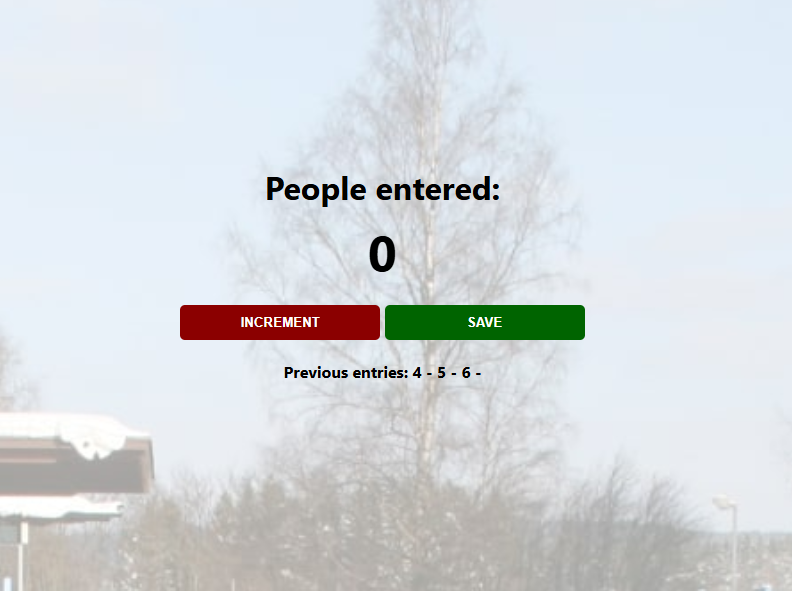

# 🚇 Simple Counter App

A passenger counter for subway stations: count people as they enter, then save the total and start a new count.

Project from the [Scrimba Fullstack Developer Path](https://scrimba.com/fullstack-path-c0fullstack) (*JavaScript Fundamentals* module), my first JavaScript app.

**🌐 Live demo:** [ScrimCounterApp](https://scrimcounterapp.netlify.app)



## ✨ Features

- **INCREMENT** adds one person to the current count
- **SAVE** stores the count in the list of previous entries (e.g. `12 - 8 - 15 -`)
- The counter **resets to 0** after each save, ready for the next train

## 🛠️ Built with

- HTML5
- CSS3
- Vanilla JavaScript (no framework, no library)

## 🧠 What I practiced

- Declaring and reassigning variables with `let`
- Writing functions and calling them with `onclick`
- Selecting elements with `document.getElementById()`
- Updating the page with `textContent` (and why it keeps spaces that `innerText` removes)
- Concatenating strings and numbers, and adding to existing text with `+=`
- Keeping the JavaScript state and the display in sync (resetting both the variable and the element)

## 🚀 Run it locally

```bash
git clone https://github.com/Hushhhy/simpleCounterApp.git
cd simpleCounterApp
```

Then open `index.html` in your browser. No installation needed.

## 🗺️ Next steps

- Add a button to clear the previous entries
- Keep the saved entries after a page refresh
- Show a timestamp next to each saved count

## 📁 Project structure

```
simpleCounterApp/
├── index.html
├── style.css
├── index.js
└── assets
    ├── station.jpg
    └── screenshot.png
```

## 🙏 Credits

- Project brief and design: [Scrimba](https://scrimba.com)
- Built by [Alexis Carpentier](https://github.com/Hushhhy)
